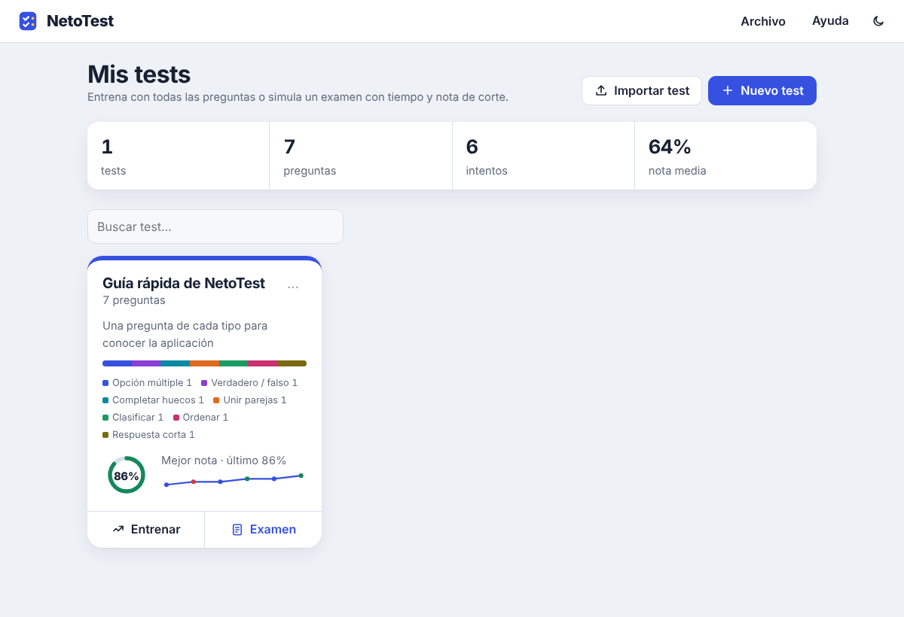
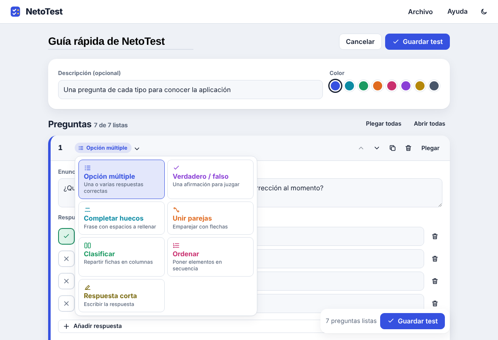
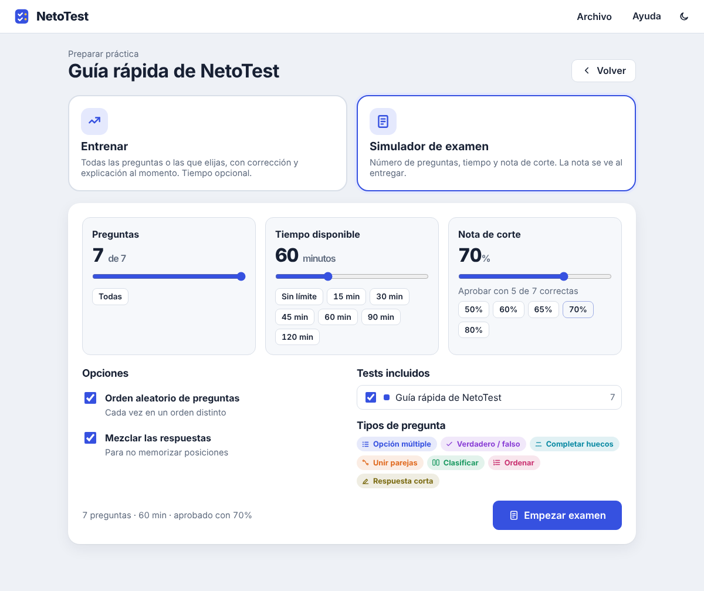
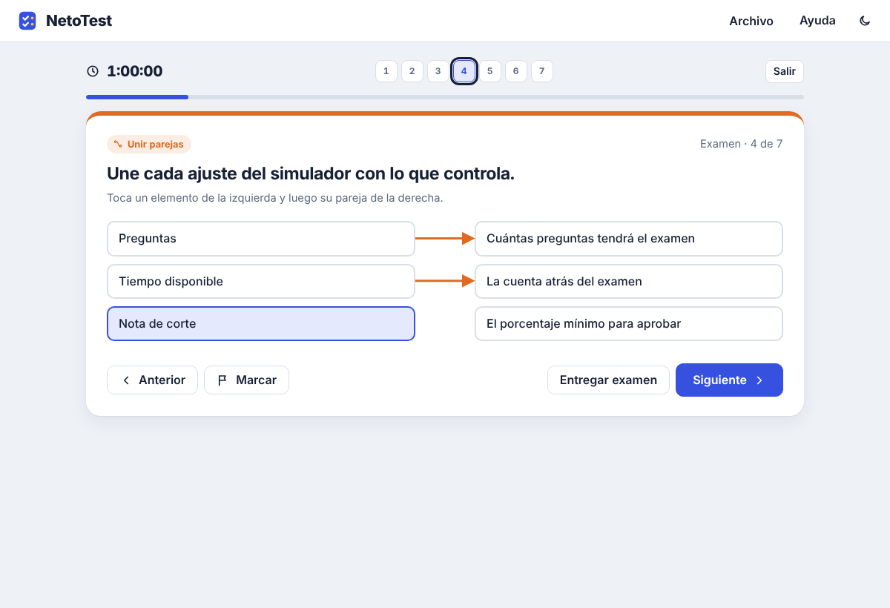
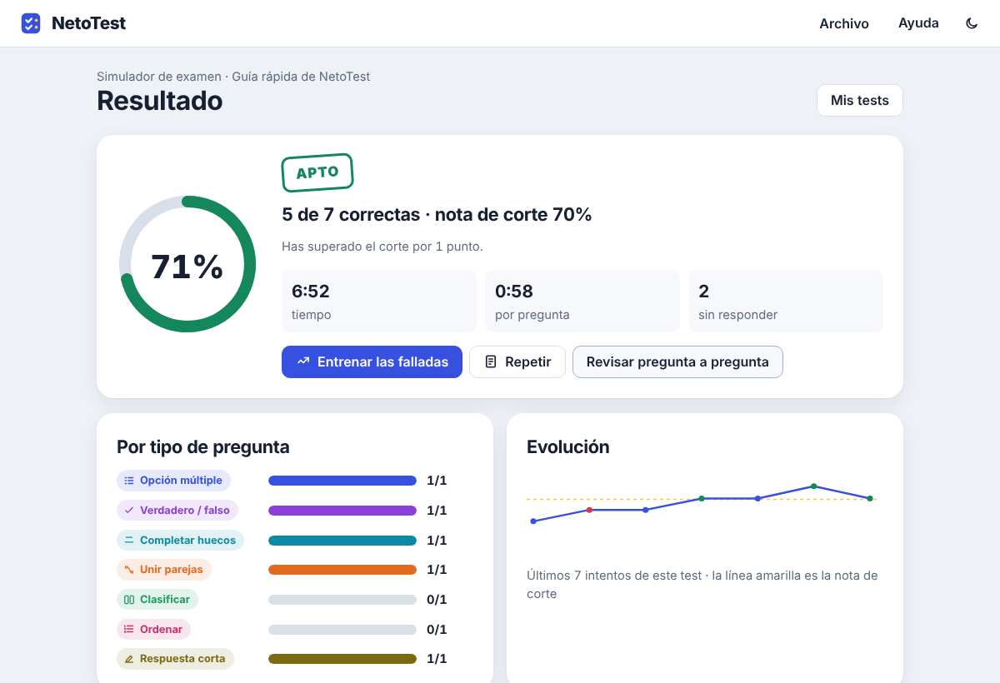

# NetoTest
Aplicación web para practicar con examees tipo test.

**Crea tests, entrena y simula exámenes con tiempo y nota de corte.** Todo en un único archivo HTML, sin instalación, sin cuentas y sin servidor: tus tests nunca salen de tu equipo.



## Úsalo como prefieras

| | Online | En local |
|---|---|---|
| **Cómo** | Abre la página del proyecto en tu navegador | Descarga `index.html` y ábrelo con doble clic |
| **Internet** | Solo para cargar la página | No hace falta nunca |
| **Tus tests** | Se guardan en tu navegador y los exportas a archivos de tu equipo | Igual: navegador + archivos de tu equipo |

- **Online:** `https://TU-USUARIO.github.io/netotest/` (cambia la dirección cuando publiques el repositorio; ver [Publicar con GitHub Pages](#publicar-con-github-pages)).
- **En local:** descarga [`index.html`](index.html) (botón *Download raw file* en GitHub), guárdalo donde quieras y ábrelo con Chrome, Edge, Firefox o Safari. Funciona sin conexión.

En los dos casos, los tests se guardan automáticamente en el navegador que estés usando. Para llevarlos a otro equipo o a otro navegador, expórtalos a archivo (JSON o TXT) e impórtalos allí.

## Funciones

**Editor visual**
- Siete tipos de pregunta, elegidos desde un menú: opción múltiple (una o varias correctas), verdadero/falso, completar huecos, unir parejas con flechas, clasificar en columnas, ordenar y respuesta corta.
- Tantas respuestas como quieras en cada pregunta.
- Imagen en cada pregunta (botón o pegar con Ctrl+V) y explicación opcional que se muestra al corregir.
- Reordenar, duplicar y plegar preguntas, y cambiar el tipo de una pregunta ya creada.



**Dos modos de práctica**
- **Entrenar:** corrección y explicación al momento, número de preguntas y tiempo opcionales, repetir al final las falladas, practicar solo las falladas o empezar por las que más fallas.
- **Simulador de examen:** eliges número de preguntas, tiempo disponible y nota de corte. Navegador de preguntas, marcar dudosas, aviso de preguntas sin responder y entrega automática al acabar el tiempo. Resultado APTO / NO APTO.
- Se pueden combinar varios tests en una misma práctica y filtrar por tipo de pregunta.





**Resultados y progreso**
- Nota, tiempo total y por pregunta, aciertos por tipo de pregunta y gráfica de evolución con la nota de corte.
- Revisión pregunta a pregunta con tu respuesta, la correcta y la explicación.
- Estadísticas por pregunta para saber cuáles te cuestan más.



**Además:** modo claro y oscuro, diseño adaptado al móvil, atajos de teclado y respeto a la preferencia de movimiento reducido del sistema.

## Importar y exportar

| Acción | Formatos | Dónde |
|---|---|---|
| Importar | `.json` (exportado desde NetoTest) · `.txt` (formato de texto con códigos) · texto pegado | Menú **Archivo → Importar test** |
| Exportar | **JSON** (completo, con imágenes) · **TXT** (con códigos, sin imágenes) · **PDF** (vista de impresión limpia, con hoja de soluciones opcional) | Menú **⋯** de cada test → **Exportar** |
| Copia de seguridad | Todos los tests con su historial en un JSON | Menú **Archivo → Copia de seguridad de todo** |

El PDF se genera desde el cuadro de impresión del navegador: elige **Guardar como PDF**. No contiene ningún código del formato, solo las preguntas listas para imprimir.

En la carpeta [`ejemplos`](ejemplos) tienes un test de muestra en los dos formatos de importación.

### Formato de texto

Una línea por elemento. El primer carácter indica qué es:

| Código | Significado |
|---|---|
| `# Título` | Título del test (primera línea) |
| `? Pregunta` | Opción múltiple; debajo, una línea por respuesta |
| `+ texto` | Respuesta correcta (puede haber varias) |
| `- texto` | Respuesta incorrecta |
| `= texto` | Explicación que se muestra al corregir |
| `?vf Afirmación` | Verdadero o falso: añade `+ V` o `+ F` |
| `?c Frase con ___` | Completar: una línea `+` por hueco; alternativas separadas con `\|` |
| `?u Enunciado` | Unir: líneas `+ izquierda => derecha` |
| `?k Enunciado` | Clasificar: líneas `+ Columna = ficha, ficha` |
| `?o Enunciado` | Ordenar: líneas `+` en el orden correcto |
| `?s Pregunta` | Respuesta corta: líneas `+` con las respuestas válidas |
| `! imagen.jpg` | Referencia a una imagen (las imágenes solo viajan en JSON) |

Ejemplo:

```text
# Mi primer test
? ¿Cuál es la capital de Portugal?
+ Lisboa
- Oporto
- Coímbra
= Lisboa es la capital desde el siglo XIII.
?vf El agua hierve a 100 °C a nivel del mar.
+ V
?c El símbolo químico del oro es ___.
+ Au
```

### Formato JSON

Cada archivo `.netotest.json` incluye un campo `como_funciona` que describe su propia estructura, así que cualquiera puede leerlo, editarlo o generarlo con otras herramientas. Las imágenes van incrustadas en base64 dentro del campo `imagenes`.

## Atajos de teclado

| Tecla | Acción |
|---|---|
| `1` – `9` | Elegir respuesta |
| `Intro` | Comprobar o pasar a la siguiente |
| `←` `→` | Moverse entre preguntas |
| `M` | Marcar como dudosa (simulador) |
| `Esc` | Cerrar menús y ventanas |

## Publicar con GitHub Pages

1. Sube este repositorio a GitHub (con `index.html` en la raíz).
2. En el repositorio, ve a **Settings → Pages**.
3. En **Build and deployment**, elige **Deploy from a branch**, rama `main` y carpeta `/ (root)`. Guarda.
4. En uno o dos minutos la aplicación estará en `https://TU-USUARIO.github.io/NOMBRE-DEL-REPOSITORIO/`.

## Privacidad

NetoTest no tiene servidor, no usa cookies de seguimiento, no carga recursos externos y no envía datos a ningún sitio. Todo lo que creas se guarda en el almacenamiento local de tu navegador y en los archivos que tú decidas exportar. Si borras los datos del navegador, también se borran los tests guardados en él, así que exporta copias de seguridad de vez en cuando.

## Contribuir

Las propuestas y mejoras son bienvenidas: abre un *issue* para comentar una idea o un *pull request* con los cambios. El proyecto es un solo archivo (`index.html`) con HTML, CSS y JavaScript sin dependencias ni paso de compilación, así que basta con editarlo y abrirlo en el navegador para probar.

## Licencia

NetoTest es software libre bajo la [Licencia Pública General GNU, versión 3 o posterior](LICENSE) (GPL-3.0-or-later).

Puedes usarlo, estudiarlo, copiarlo, modificarlo y distribuirlo libremente. Si distribuyes una versión modificada, debe publicarse también bajo la GPL v3 y con su código fuente, para que siga siendo libre para todos.

Los tests que crees con NetoTest son tuyos: la licencia se aplica al programa, no al contenido de tus tests.
